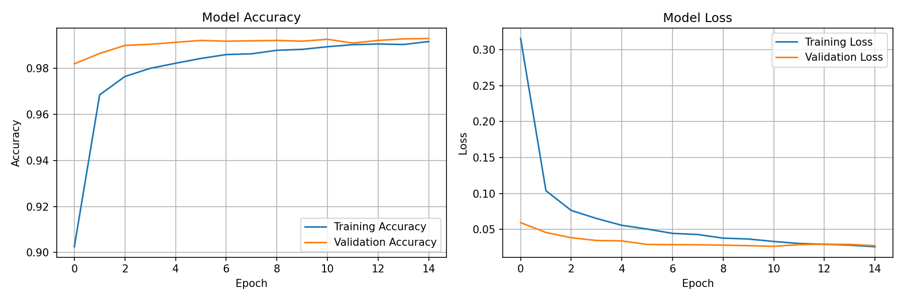
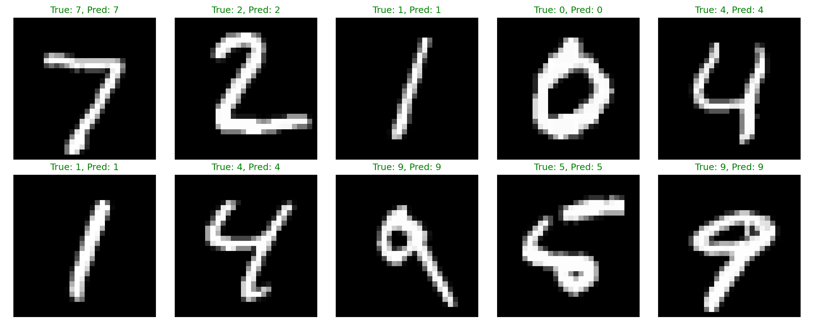
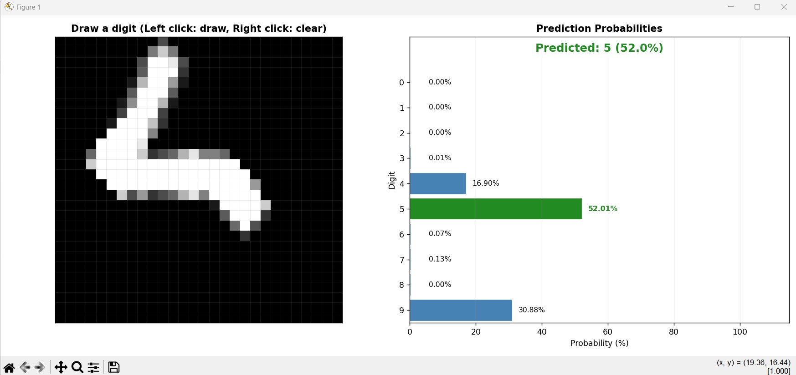
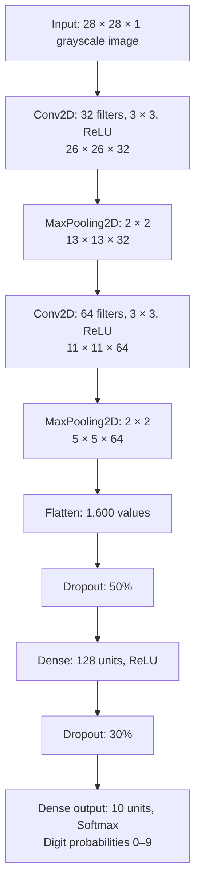

# Character Recognition

MNIST (Modified National Institute of Standards and Technology) digit
recognition project using TensorFlow and Keras. The Jupyter notebook
explores the MNIST dataset, and the training script builds a CNN model achieving
**99.38% test accuracy**.

## What is here

- [character_recognition.ipynb](character_recognition.ipynb): MNIST exploration and visualization.
- [train_model.py](train_model.py): TensorFlow CNN training script.
- [predict_digit.py](predict_digit.py): Predict digits using the trained model.
- [predict_digit_while_drawing.py](predict_digit_while_drawing.py): Interactive drawing application with live predictions.
- [character_recognition.py](character_recognition.py): Simple plotting smoke test.
- [main.py](main.py): Minimal entry point placeholder.
- `mnist/`: Raw MNIST IDX files (train/test images and labels).

## Requirements

- Python >= 3.11, < 3.14
- Dependencies: `numpy`, `matplotlib`, `tensorflow`

If you are using `uv`, it will read dependencies from [pyproject.toml](pyproject.toml).

## Quick start

### Train the model

Train a CNN on the MNIST dataset:

```bash
uv run train_model.py
```

This will:

- Load 60,000 training images and 10,000 test images from IDX files
- Train a 2-layer CNN with dropout for 15 epochs
- Evaluate the model on the test set
- Save the trained model to `mnist_model.keras`
- Generate visualization plots saved to the current working directory: `training_history.png` and `predictions.png`

[](./training_history.png)

[](./predictions.png)


### Explore the data

Open the notebook and run the cells in order (VS Code or Jupyter Lab):

```bash
jupyter lab
```

The notebook demonstrates:

- Loading individual MNIST images from IDX files
- Displaying sample digits with their labels
- Understanding the 28×28 grayscale format

### Make predictions

Predict a digit from the test set using the trained model:

```bash
# Predict a specific image (e.g., image #42)
uv run predict_digit.py 42

# Predict a random image
uv run predict_digit.py
```

The script will:

- Load the trained model from `mnist_model.keras`
- Display the selected image
- Show the predicted digit with confidence score
- Display probability distribution for all digits (0-9)
- Indicate whether the prediction is correct

### Draw and predict interactively

Launch the interactive drawing application:

```bash
uv run predict_digit_while_drawing.py
```

This opens an interactive window where you can:

- **Left click and drag** to draw digits on a 28×28 canvas
- **Right click** to clear the canvas
- See **live prediction probabilities** update as you draw
- The predicted digit is highlighted in green with its confidence score

[](./doc/interactive_live_prediction.jpg)

## Model architecture

The CNN consists of:

- Two convolutional blocks (Conv2D → MaxPooling2D)
- Flatten layer
- Two dense layers with dropout (50% and 30%)
- Softmax output (10 classes)



Dropout is active during training only.

Total parameters: ~225K

### What the layers and activations do

- **Conv2D (2D convolution):** Slides small 3 × 3 filters over the image
  and produces maps showing where learned patterns appear. The first layer
  can learn simple features such as edges; the second can combine them into
  more complex shapes useful for recognizing digits. This model learns 32
  filters in the first layer and 64 in the second.
- **MaxPooling2D:** Shrinks each feature map by taking the largest value in
  each 2 × 2 area. This keeps strong detected features while reducing the
  amount of data the later layers need to process.
- **Flatten:** Turns the 5 × 5 × 64 feature maps into one list of 1,600
  values so they can be passed to the dense layers. It does not learn or
  change the values.
- **Dropout:** Randomly sets some values to zero during training (50% and
  later 30% in this model). This helps prevent the model from relying too
  heavily on particular features and can improve its performance on
  images it has not seen before. Dropout is turned off for predictions.
- **Dense:** Connects every input value to each of its units. The hidden
  dense layer combines the detected features using 128 units to help
  decide which digit the image represents.
- **ReLU (rectified linear unit):** An activation function that replaces
  negative values with zero and leaves positive values unchanged. It adds
  nonlinearity, helping the model learn more complex patterns than a
  simple linear calculation could.
- **Dense output:** The final dense layer has 10 units, one for each
  possible digit from 0 to 9. Each unit produces a score for its digit.
- **Softmax:** Converts those 10 scores into probabilities that add up
  to 1. The digit with the highest probability is the model's prediction.

## Results

**Accuracy** is the fraction of images for which the model's most likely
digit matches the correct label. For example, 99.38% test accuracy means
the model correctly classified about 99 out of every 100 test images.

**Loss** measures how well the predicted probabilities match the correct
labels. This model uses *sparse categorical cross-entropy*: for each image,
it looks at the probability assigned to the correct digit. A higher
probability gives a smaller loss, while a confident wrong prediction gives
a large loss. The reported test loss is the average across the test set;
0.0204 is a loss value, not a percentage.

The difference is that accuracy only checks whether the top prediction is
right, while loss also considers the probabilities. For example, predictions
that assign 51% and 99% to the correct digit can both be accurate, but the
99% prediction has a lower loss. During training, the optimizer adjusts the
model to reduce loss; accuracy provides an easier-to-read measure of how
often it gets the answer right.

- **Test accuracy**: 99.38%
- **Test loss**: 0.0204
- Training time: ~90 seconds (15 epochs on CPU)

## Notes

- IDX files are loaded with custom binary readers (see [train_model.py](train_model.py))
- The model uses data normalization (pixel values scaled to [0, 1])
- Validation split: 10% of training data
